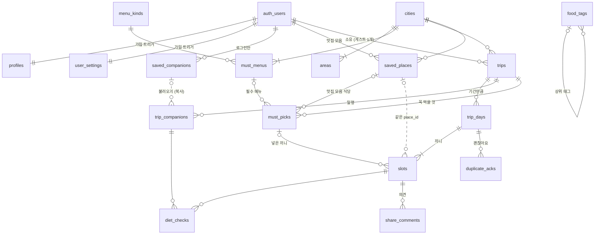
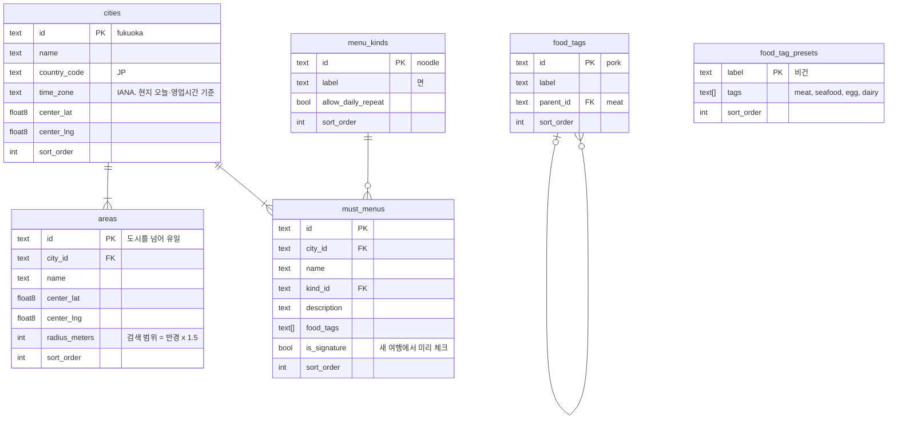
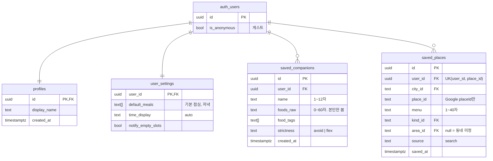
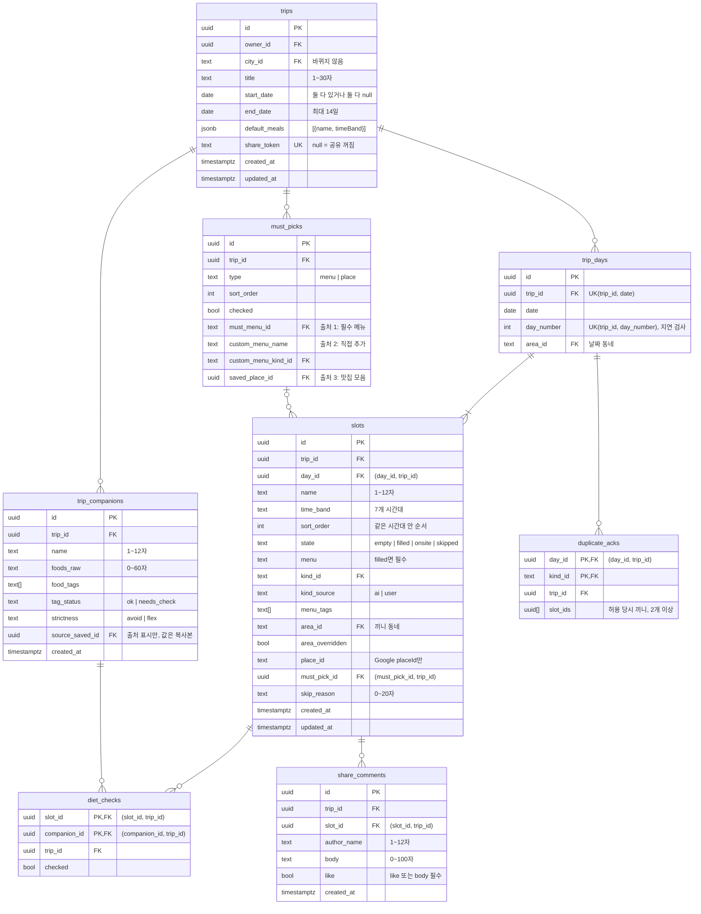

# ERD — Wayfarer 데이터베이스 구조

- DB: Supabase PostgreSQL 15 이상 + Supabase Auth (`auth.users`)
- 원본: `supabase/migrations/0001~0007`. 이 문서와 마이그레이션이 다르면 마이그레이션이 맞다
- 한 파일로 보기: `DB/init.sql`(스키마 전체 = 마이그레이션 합본), `DB/data.sql`(초기 데이터 = 마스터 데이터). 둘 다 `uv run python -m app.seed.master_data --sql`이 만든다
- 검증: `tests/db` (제약·RLS·외래 키 인덱스, API 흐름을 자동 확인)
- 규칙 근거: 프론트 레포 `docs/BUSINESS_LOGIC.md`, `docs/API_SPEC.md`, `docs/DATABASE.md`

이 문서는 **어떤 표에 무엇을 저장하고, 데이터를 적게·한 번만 저장하려고 무엇을 저장하지 않는지**를 한눈에 보여준다.

---

## 1. 효율적으로 저장하기 위한 원칙

| # | 원칙 | 적용 | 얻는 것 |
|---|---|---|---|
| 1 | 계산할 수 있는 값은 저장하지 않는다 | 하루 중복, 식이 상태, 완성 지표, 휴무 판정, 여행 목록 숫자 | 끼니 하나를 바꿔도 다른 행을 고칠 일이 없다. 값이 어긋나지 않는다 |
| 2 | 외부 데이터는 id만 저장한다 | 식당은 Google `place_id`만 | 행이 작고, 이름·영업시간이 낡지 않는다 (Places 약관 C-8) |
| 3 | 같은 값은 한 곳에만 둔다 | 끼니 날짜는 `trip_days.date`에만, 도시 이름은 `cities`에만 | 고칠 곳이 하나다 |
| 4 | 마스터 데이터는 짧은 슬러그 키 | `fukuoka`, `tenjin`, `noodle` | 조인 없이 읽을 수 있고 시드 JSON과 같다 |
| 5 | 여행에 딸린 행은 모두 `trip_id`를 갖는다 | 끼니·일행·식이 체크·허용 기록·꼭 먹을 것·의견 | 여행 상세를 `trip_id` 하나로 읽고, 권한(RLS)도 조인 없이 판단한다 |
| 6 | 작은 고정 목록은 배열로 | 음식 태그 `text[]`, 기본 끼니 `jsonb`, 허용 끼니 `uuid[]` | 연결 테이블과 조인이 필요 없다 (태그로 검색하지 않는다) |
| 7 | 인덱스는 실제 조회·삭제 경로에만 | 4장 표. 대부분 비어 있는 열은 부분 인덱스 | 쓰기 비용과 저장 공간을 아낀다 |
| 8 | 열거값은 `text` + `check` | `state in ('empty', …)` | 값 추가가 마이그레이션 한 줄이다 |

---

## 2. ERD

`PK` 기본 키 · `FK` 외래 키 · `UK` 유일. 실선은 외래 키, 점선은 값으로만 이어지는 논리 관계다.

### 2.1 전체 관계



### 2.2 마스터 데이터 (`0001_catalog.sql`)

누구나 읽기만 한다. 쓰기는 시드(service_role)만. 원본은 `data/master-data/*.json`.



### 2.3 사용자 (`0002_identity.sql`, `0004_places.sql`)

계정은 Supabase Auth가 갖는다. 게스트도 `auth.users`의 익명 행이고, 로그인하면 **같은 id**로 연결돼 데이터가 그대로 이어진다.



### 2.4 여행 (`0003_trips.sql`, `0005_sharing.sql`)



### 2.5 관계 요약

| 관계 | 카디널리티 | 지키는 방법 | 부모를 지우면 |
|---|---|---|---|
| 사용자 — 여행 | 1 : N, 게스트는 1 : 0..1 | FK + 서비스 409 + RLS | 여행과 딸린 행 전부 삭제 |
| 사용자 — 설정·프로필 | 1 : 1 | 기본 키 = 사용자 id, 가입 트리거 | 삭제 |
| 사용자 — 자주 함께 가는 일행 | 1 : N, 게스트는 0 | FK + 서비스 403 + RLS | 삭제 |
| 사용자 — 맛집 모음 | 1 : N, 같은 식당은 한 번 | UK(user_id, place_id) | 삭제 |
| 여행 — 일차 | 1 : 0..14 | UK(trip_id, date), 기간 check | 삭제 |
| 일차 — 끼니 | 1 : 1..N | 복합 FK (day_id, trip_id) | 메뉴·식당과 함께 삭제 |
| 끼니 × 일행 — 식이 체크 | N : M | 기본 키 (slot_id, companion_id), 복합 FK 2개 | 삭제 |
| 일차 × 종류 — 허용 기록 | 0..1 | 기본 키 (day_id, kind_id) | 삭제 |
| 여행 — 꼭 먹을 것 | 1 : N, 출처는 정확히 하나 | check `must_picks_source`, 식당은 RLS로 본인 것만 | 삭제 |
| 꼭 먹을 것 — 끼니 | 1 : 0..1 (명세) | 복합 FK. **1개 제한은 아직 서비스만** (6장) | 끼니의 연결만 null |
| 맛집 모음 — 꼭 먹을 것 | 1 : N | FK | 꼭 먹을 항목 삭제 |
| 자주 함께 가는 일행 — 여행 일행 | 1 : N, 복사 | FK (출처 표시) + RLS로 본인 것만 | 여행 일행은 남고 출처만 null |
| 끼니 — 의견 | 1 : N | 복합 FK (slot_id, trip_id) | 삭제. 공유를 꺼도 남는다 |

**같은 여행끼리만 연결:** 외래 키 검사는 RLS를 거치지 않는다. 그래서 `trip_days`·`slots`·`trip_companions`·`must_picks`에 `UK(id, trip_id)`를 두고, 자식은 `(부모 id, trip_id)` 복합 외래 키로 가리킨다. 남의 여행 끼니에 체크·의견·꼭 먹을 항목을 붙일 수 없다.

---

## 3. 저장하지 않는 값

API 응답에는 있지만 DB에는 없는 값이다. 조회할 때 만든다.

| 응답 값 | 만드는 곳 | 저장하지 않는 이유 |
|---|---|---|
| 하루 중복·식이 상태·완성 지표·휴무 판정·홈 상태·여행 묶음 | 프론트 `src/domain` | 원칙 1. 화면이 그릴 때마다 계산한다 |
| `TripSummary.slotCounts`, `companionCount` | `trip_summaries` 뷰가 셈 | 여행 하나에 끼니가 많아야 200개라 세는 비용이 작다. 저장하면 끼니를 바꿀 때마다 고쳐야 한다 |
| `TripSummary.cityName`, `timeZone` | `cities` 조인 | 원칙 3 |
| `Slot.date` | `trip_days.date` | 원칙 3 |
| 식당 이름·주소·영업시간·평점 (`PlaceSummary`) | Google Places, 짧은 캐시 | 원칙 2, Places 약관 |
| `MustPick.display`, `placedSlotId` | 마스터 데이터·맛집 모음·`slots.must_pick_id` | 원본을 고치면 저절로 반영 |
| `SavedPlace.place`, `placements` | Places, `slots.place_id` | 위와 같음 |
| `SharedTrip.ownerName`, 동네·식당 이름 | `profiles`, `areas`, Places | 공유 응답을 만들 때 조합 |
| `ShareLink.url` | `/share/{token}` | 토큰에서 만든다 |
| 세션·토큰 | Supabase Auth | 목의 세션은 Phase 1 전용 |

---

## 4. 인덱스와 조회 경로

| API | 읽기·쓰기 | 인덱스 |
|---|---|---|
| `GET /trips` | `trip_summaries` 한 번 | `trips_owner_idx`, `slots_trip_idx`, `trip_companions_trip_idx` |
| `POST /trips` | 여행·일차·끼니·꼭 먹을 것·일행을 한 트랜잭션에 삽입 | 삽입만 |
| `GET /trips/{id}` | 7개 표를 `trip_id`로, PostgREST 관계 조회 한 번 | `trip_days_date_unique`, `slots_trip_idx`, `trip_companions_trip_idx`, `must_picks_trip_idx`, `diet_checks_trip_idx`, `duplicate_acks_trip_idx` |
| `PATCH /trips/{id}` 기간 축소 | 일차 삭제 → 끼니 → 식이 체크·의견 연쇄 | `slots_day_idx`, `share_comments_slot_idx` |
| `PATCH /slots/{id}` | 끼니 1 수정 + 허용 기록 정리 + 식당 교체 시 식이 체크 삭제 | 기본 키, `duplicate_acks_trip_idx` |
| `DELETE /trips/{id}/companions/{id}` | 일행 → 식이 체크 연쇄 | `diet_checks_companion_idx` |
| `PUT /trips/{id}/must-picks` | 목록 교체 → 끼니 연결 비우기 | `must_picks_trip_idx`, `slots_must_pick_idx` (부분) |
| `GET /collection` | 맛집 모음 + 넣은 끼니를 `place_id`로 | `saved_places_user_city_idx`, `slots_place_idx` (부분) |
| `DELETE /collection/{id}` | 맛집 모음 → 꼭 먹을 항목 연쇄 | `must_picks_saved_place_idx` (부분) |
| `DELETE /me/companions/{id}` | 여행 일행의 출처 비우기 | `trip_companions_source_saved_idx` (부분) |
| `GET /trips/{id}/comments` | 의견을 `trip_id`로 | `share_comments_trip_idx` |
| `GET /share/{token}` | 여행을 토큰으로 + 여행 상세와 같은 읽기 | `trips_share_token_key` |
| 모든 여행 API의 RLS | `is_trip_owner(trip_id)` | `trips` 기본 키 |

- 사용자 데이터를 가리키는 외래 키에는 그 열로 시작하는 인덱스가 반드시 있다. 부모를 지울 때 자식을 표 전체에서 찾지 않기 위해서다(`tests/db`가 확인).
- 마스터 데이터를 가리키는 외래 키(`city_id`, `area_id`, `kind_id` …)에는 두지 않는다. 마스터 데이터는 거의 지우지 않아 인덱스가 쓰기 비용만 늘린다.
- `slots.place_id`, `slots.must_pick_id`처럼 대부분 비어 있는 열은 `where … is not null` 부분 인덱스로 크기를 줄인다.

---

## 5. 권한 (RLS, `0006_rls.sql`)

| 대상 | 읽기 | 쓰기 |
|---|---|---|
| 마스터 데이터 6개 표 | 누구나 | 시드(service_role)만 |
| `profiles`, `user_settings` | 본인 | 본인 수정 (생성은 가입 트리거) |
| `saved_companions` | 본인 | 본인, **게스트는 추가 불가** |
| `saved_places` | 본인 | 본인 (게스트 가능) |
| `trips` | 소유자 | 소유자, **게스트는 1개까지** |
| 여행에 딸린 표 | 여행 소유자 | 여행 소유자. 남의 맛집 모음·저장 일행은 연결 불가 |
| `share_comments` | 여행 소유자 | 소유자는 삭제만. 쓰기는 sharing 서비스(service_role) |
| `trip_summaries` | 소유자 (`security_invoker`) | — |

---

## 6. 데이터 크기와 남은 일

| 항목 | 예상 크기 |
|---|---|
| 여행 1개 | 일차 ≤14, 끼니 ≤약 100, 일행 ≤20, 꼭 먹을 것 ≤약 20 |
| 사용자 1명 | 여행 수십 개, 맛집 모음 수백 개 |
| 마스터 데이터 | 도시당 동네·필수 메뉴 10개 안팎 |

표 하나가 수백만 행이 되기 전까지는 파티션 없이 위 인덱스로 충분하다.

| 남은 일 | 내용 | 시점 |
|---|---|---|
| 꼭 먹을 항목 1 : 0..1 | `slots (must_pick_id) where must_pick_id is not null and state <> 'skipped'` 부분 유일 인덱스. 지금은 서비스만 막는다 | B3 trips 모듈과 함께 새 마이그레이션 |
| 게스트 데이터 정리 | 30일 넘게 활동이 없는 익명 사용자를 `pg_cron`으로 삭제. `auth.users`를 지우면 모든 표가 외래 키로 함께 지워진다 | B7 배포 |
| 공동 편집 (P2) | `trip_members (trip_id, user_id, role)`, `slots.version` | P2 |

```sql
-- 게스트 정리 예시 (pg_cron 확장을 켠 뒤 등록)
delete from auth.users
where is_anonymous and coalesce(last_sign_in_at, created_at) < now() - interval '30 days';
```

스키마를 바꿀 때는 새 번호의 마이그레이션을 더하고, 이 문서와 `tests/db`를 같은 커밋에서 고친다.
